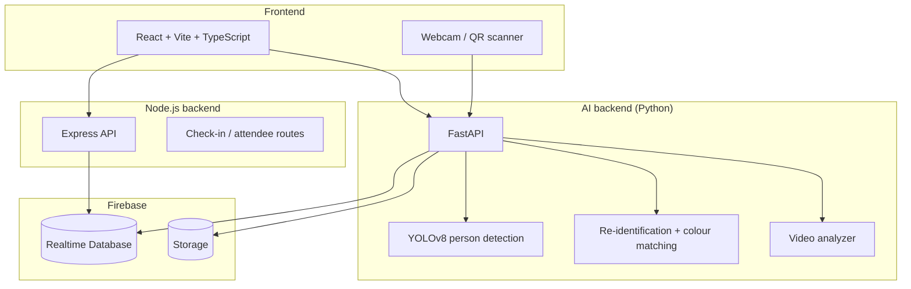

<h1 align="center">Echoplex</h1>
<h3 align="center">AI-Powered Event Safety Intelligence Platform</h3>

<p align="center">
  Real-time crowd monitoring, missing-person detection and safety management for large events
</p>

<p align="center">
  
  
  
  
  
  
</p>

---

## Overview

Large events such as concerts, festivals and conferences struggle with three recurring safety problems: people getting lost, zones becoming dangerously overcrowded, and incidents being reported too slowly. **Echoplex** gives event organisers one command dashboard that combines:

- **QR-based check-in** to know exactly how many people are in each zone
- **Computer vision** (YOLOv8 person detection + clothing-based re-identification) to find missing persons in camera footage
- **Crowd analytics** that flag zones approaching capacity and forecast surges before they happen
- **Incident management** so staff can log, track and respond to safety issues in real time

Built as a final-year B.E. team project (three members) at Cummins College of Engineering, Pune, 2025–26.

---

## Features

### Check-in and attendance
- Ticket-ID based check-in and check-out
- Zone-specific QR codes and an in-browser QR scanner
- Bulk CSV import for 10,000+ attendees
- Live attendance and per-zone occupancy

### Lost and found (AI)
- Register a missing person with a photo and description
- Scan uploaded videos or a live webcam feed for matches
- YOLOv8 person detection with clothing-colour and appearance matching
- Multi-frame (temporal) checks to cut false matches
- Instant match alerts over WebSockets

### Crowd analytics
- Capacity tracking and risk levels per zone
- Crowd surge prediction using linear regression and K-means clustering
- Anomaly detection on occupancy trends

### Safety operations
- Incident logging and tracking
- Resource dispatch view for security staff

---

## Architecture



---

## Tech stack

| Layer | Technologies |
|-------|--------------|
| Frontend | React 18, TypeScript, Vite, Tailwind CSS, React Router, react-webcam, qr-scanner |
| API server | Node.js, Express 5, TypeScript |
| AI backend | Python, FastAPI, Ultralytics YOLOv8, OpenCV, PyTorch, scikit-learn, ChromaDB |
| Data | Firebase Realtime Database, Firebase Storage |
| Deployment | Vercel (frontend), Render (backends, see `render.yaml`) |

---

## Getting started

### Prerequisites
- Node.js 18+
- Python 3.10+
- A Firebase project with Realtime Database and Storage enabled

### 1. Clone and configure
```bash
git clone https://github.com/anbreen-shabir/echoplex.git
cd echoplex
cp .env.example .env      # then fill in your Firebase values
```

### 2. Frontend and Node.js API
```bash
npm install
npm run dev:full          # starts Vite and the Express server together
```

### 3. AI backend
```bash
cd ai_backend
python -m venv venv
source venv/bin/activate  # Windows: venv\Scripts\activate
pip install -r requirements.txt
python main.py
```
The YOLOv8 model weights (`yolov8n.pt`) download automatically on first run.

### 4. Lost-and-found backend (optional)
```bash
cd echoplex-backend
pip install -r requirements.txt
# add your Firebase service account file as serviceAccountKey.json
uvicorn main:app --port 8001
```

---

## Project structure

```
echoplex/
├── src/                 React frontend
│   ├── components/      Dashboard, LostAndFound, CrowdMonitor, CheckIn, ...
│   ├── services/        API helpers
│   └── firebase.ts      Firebase setup (reads values from .env)
├── Server/              Node.js + Express API
│   └── routes/          Attendee and check-in routes
├── ai_backend/          FastAPI service: detection, re-ID, video analysis
├── echoplex-backend/    FastAPI service: case registration and photo matching
├── docs/                Project and technical reports
├── render.yaml          Render deployment blueprint
└── .env.example         Environment variables template
```

---

## API reference

### Node.js API (`/api`)

| Method | Endpoint | Description |
|--------|----------|-------------|
| POST | `/attendees/bulk-import` | Import attendees from CSV |
| POST | `/attendees/check-in` | Check in an attendee |
| POST | `/attendees/check-out` | Check out an attendee |
| GET | `/attendees/status/:ticketId` | Get attendee status |
| DELETE | `/attendees/clear/:eventId` | Clear an event's attendees |

### AI backend

| Method | Endpoint | Description |
|--------|----------|-------------|
| POST | `/api/register-case` | Register a missing person |
| POST | `/api/analyze-video` | Scan a video for matches |
| POST | `/api/scan` | Scan a live camera frame |
| GET | `/api/cases` | List registered cases |
| WS | `/ws/notifications` | Real-time match alerts |
| GET | `/health` | Health check |

---

## How the AI works

- **Detection:** YOLOv8n finds every person in a frame, with an OpenCV HOG detector as a fallback on low-resource machines.
- **Re-identification:** each detected person is described by clothing colours and appearance features, which are compared against registered missing-person cases.
- **Temporal check:** a match must hold across several frames before an alert is raised, so a single blurry frame doesn't trigger a false alarm.
- **Crowd forecasting:** occupancy history per zone feeds a regression model and clustering to flag zones likely to exceed safe capacity.

Full details are in [`docs/technical-report.md`](docs/technical-report.md).

---

## Privacy note

The lost-and-found module processes images of people. In any real deployment, footage should only be analysed with consent and in line with local data-protection rules, and uploaded photos are excluded from this repository.
